# hi, i'm `icreaterandomapps`

mostly interested in tech and software, pro vibecoder

### about me

* the username is literal — i create random apps
* based in iran
* into os dev, emulation and retro computing — i build software that probably shouldn't exist
* obsessed with making things tiny and fast (see: windows xp in 43 mb)
* i also design custom cursors and test them in the browser
* 17 repos and counting, most of them born from a "what if..."

### stuff i've made

* [**PaperOS**](https://github.com/icreaterandomapps/PaperOS) — custom x86 GUI OS built from scratch: no linux, no other os base, just C, MinGW and Python
* [**Emuify**](https://github.com/icreaterandomapps/Emuify) — Android emulator based on googles REAL emulator
* [**XP43**](https://github.com/icreaterandomapps/XP43) — windows xp in just 43 MB
* [**mfile**](https://github.com/icreaterandomapps/mfile) — simple file manager written in C++
* [**CMatrix Windows**](https://github.com/icreaterandomapps/cmatrix-windows) — `cmatrix` for windows
* [**misc-files**](https://github.com/icreaterandomapps/misc-files) — a pile of tools too small to get their own repos
* **WaspiVPN** — VPN/config tool ***(RELEASE LATER)***
* **MineOptiPort** — 1.8 OptiFine Minecraft launcher stuff *(RIP — accidentally deleted it, it was 100-400 MB)*

### languages

`Python`.`Batch`.`C`.`C++`.`Assembly`.`HTML`.`Linux`

 

### websites/creations

* https://icreaterandomapps.github.io — main site
* https://icreaterandomapps.github.io/cursortest — cursor tester
* https://icreaterandomapps.github.io/n5100 — n5100
* https://www.rw-designer.com/user/121950 — my cursors on rw-designer

### github stats

<picture>
  <source media="(prefers-color-scheme: dark)" srcset="https://raw.githubusercontent.com/icreaterandomapps/icreaterandomapps/output/github-contribution-grid-snake-dark.svg" />
  <source media="(prefers-color-scheme: light)" srcset="https://raw.githubusercontent.com/icreaterandomapps/icreaterandomapps/output/github-contribution-grid-snake-white.svg" />
  
</picture>

 

